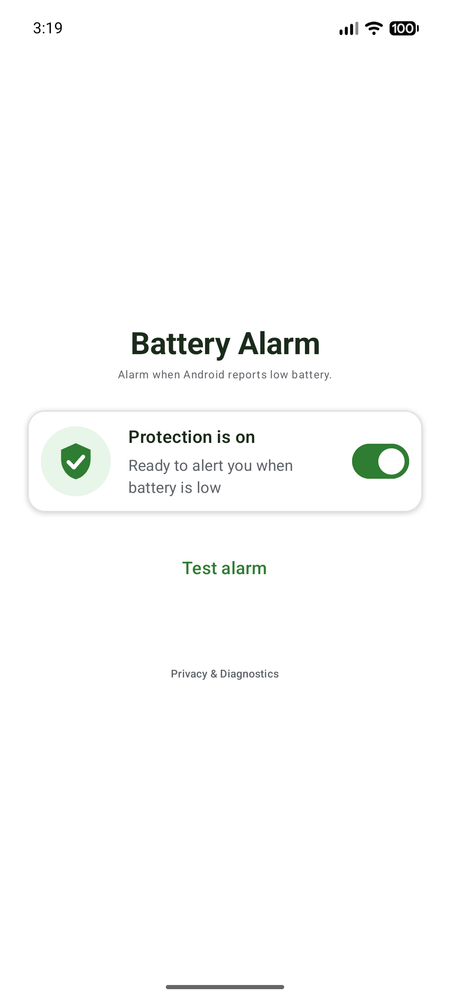
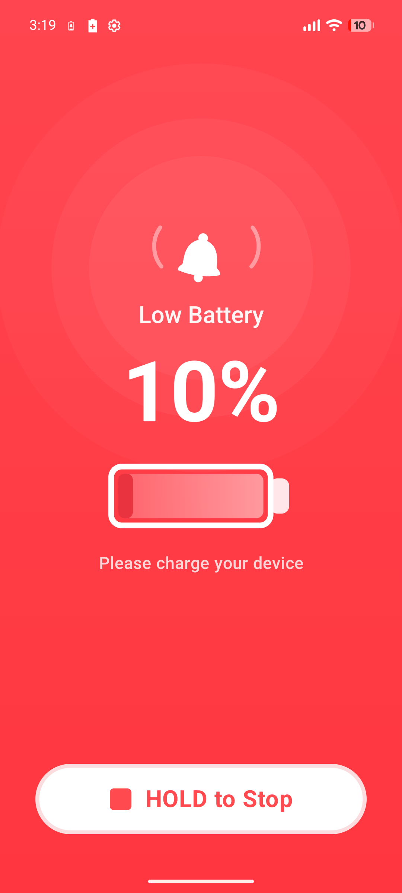
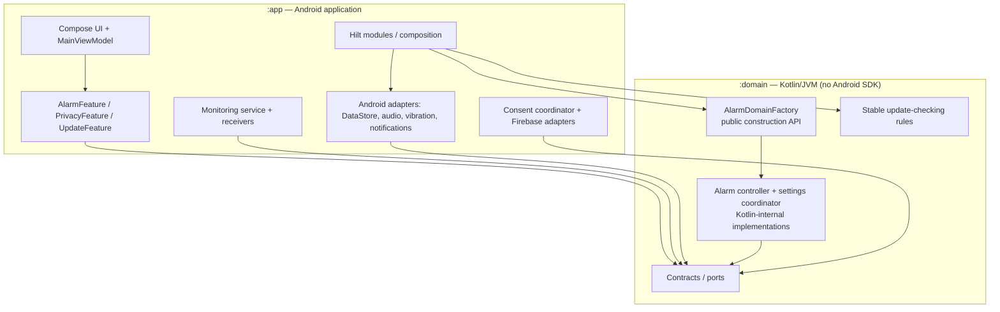

# Battery Alarm

[](https://github.com/Kravet/BatteryAlarm/actions/workflows/android-ci.yml)

A small Android app that monitors for Android's low-battery event and raises an audible, vibrating alarm with an actionable notification. The core alarm runs locally; analytics and crash reporting are optional and subject to separate user choices.

This repository is also an **architecture case study**: a deliberately compact example of separating Android integration from testable Kotlin business logic, with documented boundaries and trade-offs.

## Screenshots

<p align="center">
  
  
</p>

## Engineering highlights

- **Android-free domain module**: alarm state transitions, settings coordination, volume ramp and stable update-checking rules live in `:domain` (Kotlin/JVM).
- **Ports and adapters**: interfaces such as `AlarmController`, `AlarmSoundPlayer`, `AlarmNotifier` and `AlarmSettingsRepository` are implemented in `:domain` or by Android adapters and composed by `:app`.
- **Hilt composition**: `:app` wires domain implementations to Android sound, vibration, notifications, DataStore and Firebase.
- **Observable settings**: DataStore drives monitoring through a single `AlarmSettingsCoordinator`.
- **Separation of concerns**: `AnalyticsAlarmController` decorates the alarm controller; the domain does not import Firebase.
- **Presentation**: `MainViewModel` combines screen state and routes UI actions; `AlarmFeature`, `PrivacyFeature` and `UpdateFeature` each own their presentation state and orchestration.
- **Consent ownership**: `PrivacyConsentRepository` stores decisions; an application-scoped coordinator applies effective choices to Firebase.

## Current architecture



**Actual Gradle dependency:** `:app -> :domain`. The domain still owns both public contracts and concrete implementations. The two default alarm implementations are Kotlin `internal`; Hilt in `:app` constructs them through the public, stateless `AlarmDomainFactory`, whose methods expose only domain interfaces. This is a Kotlin source-level boundary between Gradle modules, not JVM, binary, or reflection isolation.

**Proposed, not implemented:** a separate `:domain-api`, `:domain-impl`, and `:composition` split could provide a stronger artifact-level boundary if that becomes worthwhile. It is not needed for the current project size.

## Key flows

**Low-battery alarm**

```text
Android ACTION_BATTERY_LOW
  → BatteryLowMonitoringService (dynamic receiver)
  → BatteryLowAlarmHandler
  → AlarmController / AnalyticsAlarmController
  → DefaultAlarmController
  → AlarmSoundPlayer + AlarmVibrator + AlarmNotifier (Android implementations)
```

The domain controller centralizes alarm state changes; concurrent transitions are serialized, and a stop can supersede a start still waiting on settings. Monitoring is controlled by persisted settings; the foreground service is restarted through the coordinator on application/boot startup.

**Settings and UI**

```text
Compose action → MainViewModel → AlarmFeature → AlarmSettingsRepository → DataStore
                                  ↑                    ↓ Flow
Compose ← MainUiState ← MainViewModel ← AlarmFeature

DataStore Flow → AlarmSettingsCoordinator → monitoring
```

**Privacy consent**

```text
Consent UI → MainViewModel → PrivacyFeature → PrivacyConsentRepository (DataStore)
                                                  ↓ effective consent
                                         FirebaseConsentCoordinator
                                                  ↓
                                         Firebase Analytics / Crashlytics
```

Consent defaults to off in the Android manifest. Dismissing the first-run consent sheet does not opt in. The collection coordinator observes **effective** permissions so an outdated consent-text version does not authorize collection. See [privacy policy](PRIVACY.md).

**App updates**: `UpdateFeature` runs an in-app checker that compares the installed version with GitHub's latest **stable** release using SemVer, throttles attempts and opens allowlisted release pages. It does not auto-install APKs or check prereleases.

## Code worth reviewing

| Concern | Implementation | Test |
| --- | --- | --- |
| Alarm state and concurrency | [DefaultAlarmController](domain/src/main/kotlin/com/example/batteryalarm/domain/DefaultAlarmController.kt) | [Controller tests](domain/src/test/kotlin/com/example/batteryalarm/domain/DefaultAlarmControllerTest.kt) |
| DI / adapter composition | [AlarmModule](app/src/main/java/com/example/batteryalarm/di/AlarmModule.kt) + [AlarmDomainFactory](domain/src/main/kotlin/com/example/batteryalarm/domain/AlarmDomainFactory.kt) | [Alarm decorator tests](app/src/test/java/com/example/batteryalarm/analytics/AnalyticsAlarmControllerTest.kt) |
| Presentation state and orchestration | [MainViewModel](app/src/main/java/com/example/batteryalarm/ui/MainViewModel.kt), [feature holders](app/src/main/java/com/example/batteryalarm/ui/feature/) | [ViewModel tests](app/src/test/java/com/example/batteryalarm/ui/MainViewModelTest.kt), [feature tests](app/src/test/java/com/example/batteryalarm/ui/feature/) |
| Privacy side effects | [FirebaseConsentCoordinator](app/src/main/java/com/example/batteryalarm/privacy/FirebaseConsentCoordinator.kt) | [Consent coordinator tests](app/src/test/java/com/example/batteryalarm/privacy/FirebaseConsentCoordinatorTest.kt) |
| Update decision logic | [CheckForAppUpdate](domain/src/main/kotlin/com/example/batteryalarm/domain/update/CheckForAppUpdate.kt) | [Update checker tests](domain/src/test/kotlin/com/example/batteryalarm/domain/update/CheckForAppUpdateTest.kt) |

## Build and tests

Requires an Android SDK, JDK 21 (as selected by the Gradle daemon toolchain), and the included Gradle wrapper.

```bash
./gradlew :domain:test :app:testDebugUnitTest
./gradlew :app:assembleDebug
```

The [Android CI workflow](.github/workflows/android-ci.yml) runs `:domain:test`, `:app:testDebugUnitTest`, `:app:assembleDebug`, and an API 35 Google APIs emulator smoke suite on pull requests and pushes targeting `master`. A manual workflow run does the same by default and can set `full_e2e` to run the full connected instrumentation suite.

The emulator smoke suite covers the low-battery broadcast and test-alarm flows. Other Android instrumented tests under `app/src/androidTest` cover UI, consent and alarm scenarios and require a connected device or emulator with relevant platform permissions. The reboot scenario is marked `@Ignore`, and the process-kill scenario is included only in the full suite. CI currently uses one API 35 emulator profile, not a device matrix.

Production APK signing uses local `keystore.properties` or environment variables (see [example](keystore.properties.example)); never commit signing material. For APK distribution channels and signing constraints, see [distribution guide](docs/distribution.md) and the [public releases repository](https://github.com/Kravet/battery-alarm-releases).

## Architectural decisions and trade-offs

| Decision | Benefit | Cost / boundary |
| --- | --- | --- |
| Two Gradle modules rather than a larger multi-module graph | Keeps a small app understandable and testable | The domain artifact still contains implementations; Kotlin `internal` prevents `:app` from importing the selected concrete classes |
| Hilt bindings in app | One discoverable place for Android/domain wiring | App composition chooses the domain implementation through a public factory and owns Android adapter construction |
| Mutable state in a synchronized domain controller | Small API, serialized output transitions | Outputs are synchronous; platform edge cases still need device validation |
| MVVM with `StateFlow` and separate one-off side effects | `MainViewModel` composes screen state while `AlarmFeature`, `PrivacyFeature` and `UpdateFeature` own focused presentation logic | Feature holders add indirection; the ViewModel remains responsible for screen-level composition |
| Separate consent observer | UI does not call Firebase directly; stored settings are authoritative | Correctness still relies on Firebase SDK and Android runtime validation |

## Future improvements

These are **proposals, not implemented features or confirmed defects**.

- **Stronger architectural isolation**: consider `:domain-api` + `:domain-impl` + `:composition` if artifact-level isolation becomes important enough to justify more modules; the current factory and Kotlin `internal` boundary leaves both contracts and implementations in `:domain`.
- **Presentation boundaries**: the three feature holders are currently classes in `:app`; consider stronger module boundaries only if their complexity justifies them.
- **Device reliability**: validate reboot, OEM battery policies, permission changes, low-battery and charging races on physical devices before broader user distribution.
- **Release readiness**: verify signed APK upgrades and Google Play compatibility independently of this architecture review.

See the maintained [engineering backlog](NEXT_STEPS.md) for priorities and release-specific checks.

---

**Scope:** this source repository demonstrates code organization and engineering decisions; it is not a certification of production reliability or platform-wide alarm delivery.
