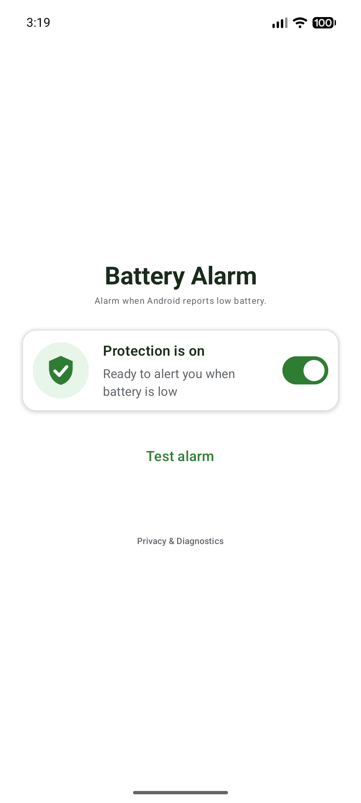
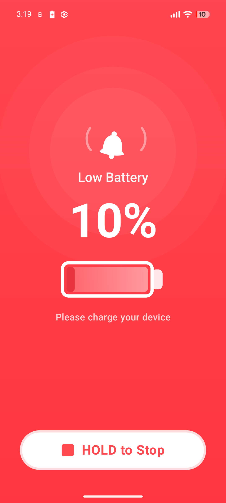
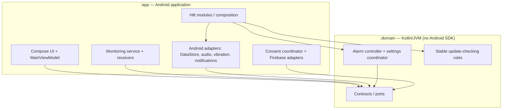

# Battery Alarm

[](https://github.com/Kravet/BatteryAlarm/actions/workflows/android-ci.yml)

A small Android app that monitors for Android's low-battery event and raises an audible, vibrating alarm with an actionable notification. The core alarm runs locally; analytics and crash reporting are optional and subject to separate user choices.

This repository is also an **architecture case study**: a deliberately compact example of separating Android integration from testable Kotlin business logic, with documented boundaries and trade-offs.

## Screenshots

<p align="center">
  
  
</p>

## Engineering highlights

- **Android-free domain module**: alarm state transitions, settings coordination, volume ramp and stable update-checking rules live in `:domain` (Kotlin/JVM).
- **Ports and adapters**: interfaces such as `AlarmController`, `AlarmSoundPlayer`, `AlarmNotifier` and `AlarmSettingsRepository` are implemented or wired by `:app`.
- **Hilt composition**: `:app` wires domain implementations to Android sound, vibration, notifications, DataStore and Firebase.
- **Observable settings**: DataStore drives monitoring through a single `AlarmSettingsCoordinator`.
- **Separation of concerns**: `AnalyticsAlarmController` decorates the alarm controller; the domain does not import Firebase.
- **Presentation**: Compose screens consume `MainUiState` and callback actions from `MainViewModel` (MVVM with unidirectional UI event/state flow).
- **Consent ownership**: `PrivacyConsentRepository` stores decisions; an application-scoped coordinator applies effective choices to Firebase.

## Current architecture



**Actual Gradle dependency:** `:app -> :domain`. The domain contains **both contracts and concrete domain classes**. `:app` can import `DefaultAlarmController` for Hilt wiring. This is a deliberate simplicity trade-off, **not a compiler-enforced implementation-access boundary**.

**Proposed, not implemented:** a later split into `:domain-api`, `:domain-impl`, and `:composition` could make implementation access compiler-enforced. It is not necessary for the current project size.

## Key flows

**Low-battery alarm**

```text
Android ACTION_BATTERY_LOW
  → BatteryLowMonitoringService (dynamic receiver)
  → BatteryLowAlarmHandler
  → AlarmController / AnalyticsAlarmController
  → DefaultAlarmController
  → AlarmSoundPlayer + AlarmVibrator + AlarmNotifier (Android implementations)
```

The domain controller centralizes alarm state changes; concurrent transitions are serialized, and a stop can supersede a start still waiting on settings. Monitoring is controlled by persisted settings; the foreground service is restarted through the coordinator on application/boot startup.

**Settings and UI**

```text
Compose action → MainViewModel → AlarmSettingsRepository → DataStore
                                               ↓ Flow
                                      MainViewModel → MainUiState → Compose
                                               ↓ Flow
                                    AlarmSettingsCoordinator → monitoring
```

**Privacy consent**

```text
Consent UI → MainViewModel → PrivacyConsentRepository (DataStore)
                                    ↓ effective consent
                           FirebaseConsentCoordinator
                                    ↓
                           Firebase Analytics / Crashlytics
```

Consent defaults to off in the Android manifest. Dismissing the first-run consent sheet does not opt in. The collection coordinator observes **effective** permissions so an outdated consent-text version does not authorize collection. See [privacy policy](PRIVACY.md).

**App updates**: an in-app checker compares the installed version with GitHub's latest **stable** release using SemVer, throttles attempts and opens allowlisted release pages. It does not auto-install APKs or check prereleases.

## Code worth reviewing

| Concern | Implementation | Test |
| --- | --- | --- |
| Alarm state and concurrency | [DefaultAlarmController](domain/src/main/kotlin/com/example/batteryalarm/domain/DefaultAlarmController.kt) | [Controller tests](domain/src/test/kotlin/com/example/batteryalarm/domain/DefaultAlarmControllerTest.kt) |
| DI / adapter composition | [AlarmModule](app/src/main/java/com/example/batteryalarm/di/AlarmModule.kt) | [Alarm decorator tests](app/src/test/java/com/example/batteryalarm/analytics/AnalyticsAlarmControllerTest.kt) |
| MVVM / UI state | [MainViewModel](app/src/main/java/com/example/batteryalarm/ui/MainViewModel.kt) | [ViewModel tests](app/src/test/java/com/example/batteryalarm/ui/MainViewModelTest.kt) |
| Privacy side effects | [FirebaseConsentCoordinator](app/src/main/java/com/example/batteryalarm/privacy/FirebaseConsentCoordinator.kt) | [Consent coordinator tests](app/src/test/java/com/example/batteryalarm/privacy/FirebaseConsentCoordinatorTest.kt) |
| Update decision logic | [CheckForAppUpdate](domain/src/main/kotlin/com/example/batteryalarm/domain/update/CheckForAppUpdate.kt) | [Update checker tests](domain/src/test/kotlin/com/example/batteryalarm/domain/update/CheckForAppUpdateTest.kt) |

## Build and tests

Requires an Android SDK, JDK 21 (as selected by the Gradle daemon toolchain), and the included Gradle wrapper.

```bash
./gradlew :domain:test :app:testDebugUnitTest
./gradlew :app:assembleDebug
```

The [Android CI workflow](.github/workflows/android-ci.yml) runs both JVM test suites and builds a debug APK for pull requests targeting `master`, pushes to `master`, and manual runs.

The project also contains Android instrumented tests under `app/src/androidTest` for UI, consent and alarm scenarios. These require a connected device or emulator and relevant platform permissions; the reboot scenario is marked `@Ignore`, while process-kill test code exists. Test sources in the repository are **not evidence that a device matrix has been executed**.

Production APK signing uses local `keystore.properties` or environment variables (see [example](keystore.properties.example)); never commit signing material. For APK distribution channels and signing constraints, see [distribution guide](docs/distribution.md) and the [public releases repository](https://github.com/Kravet/battery-alarm-releases).

## Architectural decisions and trade-offs

| Decision | Benefit | Cost / boundary |
| --- | --- | --- |
| Two Gradle modules rather than a larger multi-module graph | Keeps a small app understandable and testable | App can import domain implementation classes |
| Hilt bindings in app | One discoverable place for Android/domain wiring | App composition layer knows concrete classes |
| Mutable state in a synchronized domain controller | Small API, serialized output transitions | Outputs are synchronous; platform edge cases still need device validation |
| MVVM with `StateFlow` and separate one-off side effects | Predictable UI ownership, focused tests | One ViewModel currently orchestrates alarm, updates and privacy |
| Separate consent observer | UI does not call Firebase directly; stored settings are authoritative | Correctness still relies on Firebase SDK and Android runtime validation |

## Future improvements

These are **proposals, not implemented features or confirmed defects**.

- **Architectural isolation**: consider `:domain-api` + `:domain-impl` + `:composition` if the implementation boundary becomes important enough to justify more modules.
- **ViewModel responsibilities**: split update/consent orchestration only if additional features make the current ViewModel difficult to evolve.
- **Device-test automation**: CI covers JVM unit tests and a debug build; automated emulator and physical-device scenarios remain a separate reliability track.
- **Device reliability**: validate reboot, process death, OEM battery policies, permission changes, low-battery and charging races on real devices before broader user distribution.
- **Release readiness**: verify signed APK upgrades and Google Play compatibility independently of this architecture review.

See the maintained [engineering backlog](NEXT_STEPS.md) for priorities and release-specific checks.

---

**Scope:** this source repository demonstrates code organization and engineering decisions; it is not a certification of production reliability or platform-wide alarm delivery.
